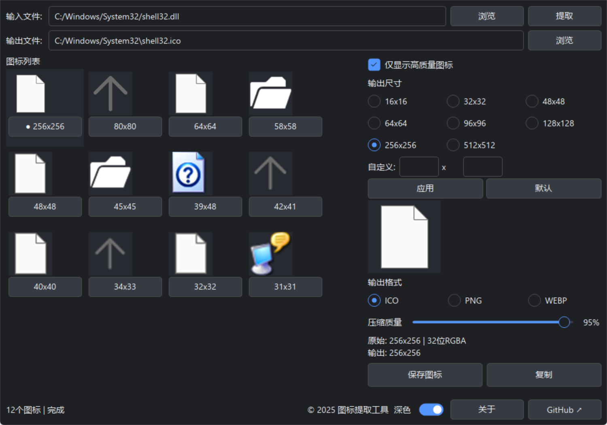
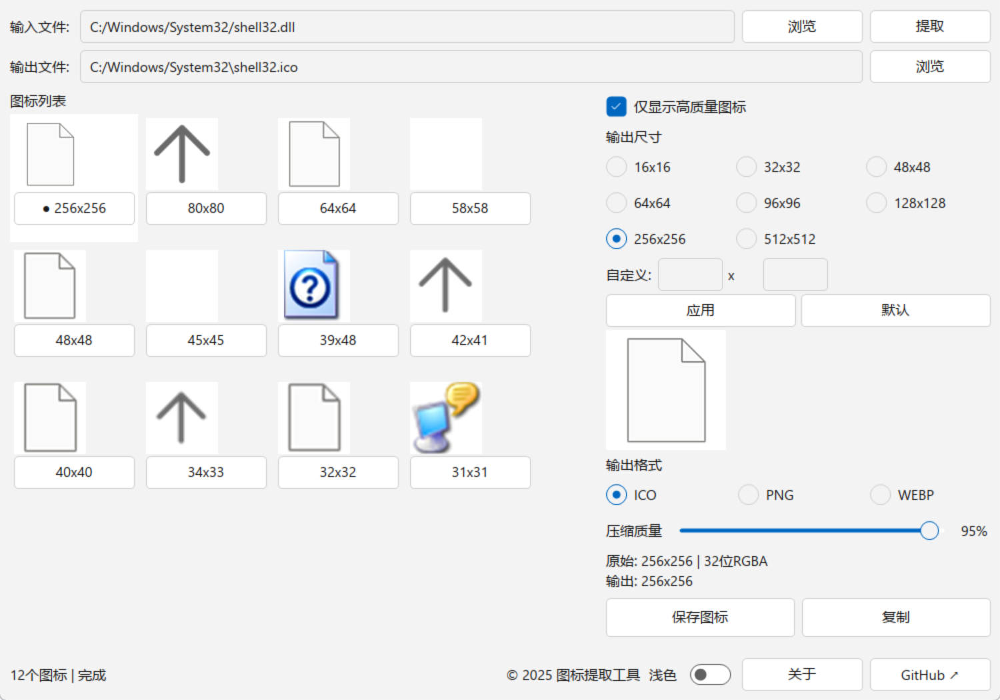

<p align="center">
  
</p>

<h1 align="center">2icon</h1>

<p align="center">
  图标提取与转换工具 —— 从图片、EXE、DLL、LNK 中提取图标，导出为多尺寸 ICO、PNG 或 WEBP。
</p>

<p align="center">
  
  
  
  
</p>

---

## 界面

<p align="center">
  
</p>

<p align="center">
  
</p>

左侧是可滚动的图标列表（按质量排序，点击即预览），右侧是尺寸、输出格式、压缩质量与预览区域。

## 特性

- 多来源提取：图像文件（PNG / JPG / WEBP / SVG）、可执行文件（EXE / DLL）、快捷方式（LNK）
- 智能排序：按分辨率与位深给图标打分，高质量图标优先展示，可一键「仅显示高质量图标」
- 多尺寸 ICO：一次写入 `256 / 128 / 96 / 64 / 48 / 32 / 24 / 16` 完整尺寸阶梯，最大尺寸排首位
- 兼容性优先的编码策略：各尺寸统一使用 DIB 条目写入，避免部分工具只认小尺寸、把 256 帧看成 128
- 输出格式：ICO、PNG、WEBP（WEBP 支持 10–100 压缩质量调节）
- 拖放即用：把文件直接拖进窗口即可开始提取
- 明暗双主题，标题栏颜色跟随主题
- 保存后自检：成功提示里回显实际写入的尺寸列表
- 复制到剪贴板：无需落盘，直接粘贴到画图、PS 等程序
- 单文件分发：`2icon.exe` 内置图标字节，脱离同目录文件也能正常运行

## 支持的输入

| 类型 | 扩展名 | 说明 |
| --- | --- | --- |
| 图像 | `.png` `.jpg` `.jpeg` `.webp` `.svg` | SVG 由 resvg 直接光栅化，长边自动抬到 256–1024 |
| 可执行文件 | `.exe` `.dll` | 解析 `RT_GROUP_ICON` / `RT_ICON`，按尺寸与位深排序 |
| 快捷方式 | `.lnk` | 通过 `IShellLink` 解析目标文件后提取其图标 |

## 输出选项

- 预设尺寸：`16` `32` `48` `64` `96` `128` `256` `512`
- 自定义尺寸：16–1024 像素，允许非方形（ICO 会自动转为方形）
- ICO 单帧上限 256：超出时自动钳制，并在保存提示中说明
- 输出路径默认跟随输入文件所在目录，可手动修改

## 架构

界面基于 [ZSUI](https://github.com/qiu7824/zsui) 的 Elm 式单向数据流：

```
用户操作 ──► Msg ──► update（状态迁移）──► 重建视图 ──► view（纯函数声明）
   ▲                                                         │
   └───────────────── 点击 / 输入 / 拖放 ◄───────────────────┘
```

| 模块 | 职责 |
| --- | --- |
| `src/main.rs` | 组装窗口、注册拖放回调、解析启动参数 |
| `src/app.rs` | `AppData` 状态与 `Msg → update` 状态迁移（提取、保存、复制等用例） |
| `src/view.rs` | 纯函数界面声明，不含任何 IO |
| `src/model.rs` | 尺寸阶梯、格式枚举、图标条目、路径推导 |
| `src/engine/ico.rs` | ICO 写入与回读，DIB 编码自行拼装 |
| `src/engine/raster.rs` | 解码、缩放、PNG/WEBP 编码、剪贴板 DIB |
| `src/engine/resource.rs` | PE 资源枚举与图标组解析 |
| `src/engine/svg.rs` | resvg 光栅化 |
| `src/engine/lnk.rs` | `IShellLinkW` 快捷方式解析 |
| `src/engine/clipboard.rs` | `CF_DIB` 写入剪贴板 |
| `src/host.rs` | ZSUI 未覆盖的 Win32 能力：文件拖放、窗口按钮、打开链接 |

ZSUI 不提供文件拖放，也没有暴露窗口句柄，`host.rs` 因此在本进程内通过
`EnumWindows` 找到主窗口并子类化窗口过程，只拦截 `WM_DROPFILES`，其余消息原样转交。

## 快速开始

需要 Rust 1.75+（2021 edition）：

```bash
# 运行
cargo run

# 运行并直接打开某个文件
cargo run -- "C:\Windows\System32\shell32.dll"
```

## 打包为 EXE

```bash
cargo build --release
# 产物：target/release/icon-tool.exe
```

仓库内置 GitHub Actions 工作流：

- `.github/workflows/build-windows.yml` —— 推送到 `main` 或打 `v*` 标签，云端构建并创建 Release，产出 `2icon.exe` 与 `2icon-portable.zip`
- `.github/workflows/ci.yml` —— 提交与 PR 上跑 `fmt` / `clippy` / `test`

## 项目结构

```
2icon/
├── src/
│   ├── main.rs             # 入口：窗口、拖放回调、启动参数
│   ├── app.rs              # 状态与 Msg 迁移
│   ├── view.rs             # 界面声明（纯函数）
│   ├── model.rs            # 数据模型与尺寸规则
│   ├── host.rs             # Win32 宿主增强（拖放 / 窗口按钮）
│   └── engine/             # 与界面无关的能力
│       ├── ico.rs          # ICO 读写（DIB 自行拼装）
│       ├── raster.rs       # 解码 / 缩放 / PNG / WEBP / DIB
│       ├── resource.rs     # PE 图标资源
│       ├── svg.rs          # SVG 光栅化
│       ├── lnk.rs          # 快捷方式解析
│       └── clipboard.rs    # 剪贴板
├── docs/                   # README 截图
├── tools/                  # 开发期界面探查脚本（Python + Pillow）
├── logo.ico / logo.png     # 应用图标与仓库 Logo
├── Cargo.toml
└── .github/workflows/      # 构建、发布与 CI
```

开发期的界面探查脚本需要 Python 与 Pillow：

```bash
pip install -r tools/requirements.txt
python tools/ui_probe.py status      # 截取当前界面
python tools/drop_probe.py logo.png  # 模拟一次文件拖放
python tools/screens.py              # 重新生成 README 截图
```

## 更新日志

### v2.0

- 使用 Rust + [ZSUI](https://github.com/qiu7824/zsui) 重写，界面与业务逻辑彻底分离，单个 exe 约 4.8MB、无运行时依赖
- 原有能力全部保留：多来源提取、质量排序与过滤、多尺寸 ICO、PNG/WEBP 输出、剪贴板、明暗主题、文件拖放
- 提取耗时进入毫秒级（`shell32.dll` 12 个图标约 12ms），无需进度条与后台线程
- ICO 编码不再依赖第三方库，DIB 条目自行拼装，写入后回读校验
- 构建流水线由 PyInstaller 改为 `cargo build --release`，并新增 `fmt` / `clippy` / `test` 的 CI

### v1.1

- 修复「选择 ICO 输出后只能导出 16x16」：ICO 尺寸阶梯不再跟随源图/所选尺寸收缩，恒定写入 8 档标准尺寸
- 修复「源图是 256 却只能看到 128」：256 档改用 DIB 编码，兼容只解析 DIB 条目的工具
- 新增：保存后回读 ICO 目录，在成功提示中回显实际写入的尺寸
- 界面：图标列表去掉格子背景（仅选中项描边高亮）；窗口固定 1000x700 并移除最小化/最大化按钮；右下角新增 GitHub 入口

### v1.0

- 首个可用版本：图标提取、ICO/PNG/WEBP 导出、明暗主题、拖放与剪贴板

## 相关链接

- 项目主页：<https://github.com/pcoof/2icon>
- 问题反馈：<https://github.com/pcoof/2icon/issues>
- UI 框架：<https://github.com/qiu7824/zsui>

---

© 2025 2icon · 使用 Rust + ZSUI 构建
