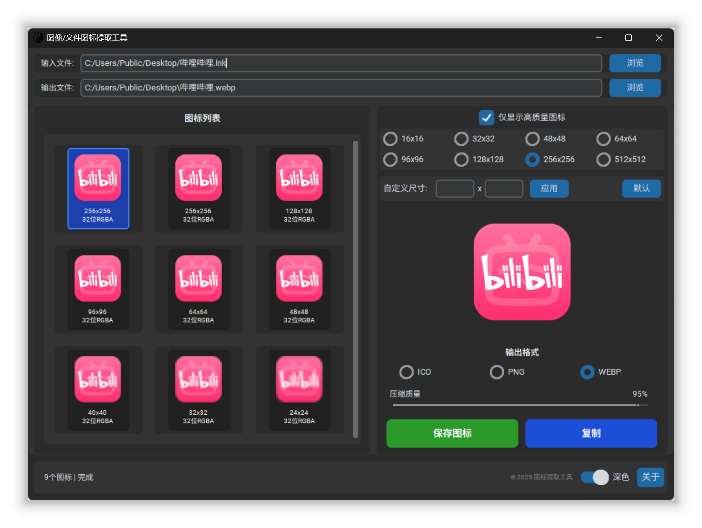

<p align="center">
  
</p>

<h1 align="center">2icon</h1>

<p align="center">
  图标提取与转换工具 —— 从图片、EXE、DLL、LNK 中提取图标，导出为多尺寸 ICO、PNG 或 WEBP。
</p>

<p align="center">
  
  
  
</p>

---

## 界面

<p align="center">
  
</p>

左侧是可滚动的图标列表（按质量排序，点击即预览），右侧是尺寸、输出格式、压缩质量与预览区域。

## 特性

- 多来源提取：图像文件（PNG / JPG / WEBP / SVG）、可执行文件（EXE / DLL）、快捷方式（LNK）
- 智能排序：按分辨率与位深给图标打分，高质量图标优先展示，可一键「仅显示高质量图标」
- 多尺寸 ICO：一次写入 `256 / 128 / 96 / 64 / 48 / 32 / 24 / 16` 完整尺寸阶梯，最大尺寸排首位
- 兼容性优先的编码策略：各尺寸统一使用 DIB 条目写入，避免部分工具只认小尺寸、把 256 帧看成 128
- 输出格式：ICO、PNG、WEBP（WEBP 支持 10–100 压缩质量调节）
- 拖放即用：把文件直接拖进窗口即可开始提取
- 明暗双主题，标题栏颜色跟随主题
- 保存后自检：成功提示里回显实际写入的尺寸列表
- 复制到剪贴板：无需落盘，直接粘贴到画图、PS 等程序
- 退出时自动清理临时文件

## 支持的输入

| 类型 | 扩展名 | 说明 |
| --- | --- | --- |
| 图像 | `.png` `.jpg` `.jpeg` `.webp` `.svg` | SVG 通过 svglib 校验 + resvg 光栅化，无需 Cairo |
| 可执行文件 | `.exe` `.dll` | 提取内嵌图标资源，按尺寸与位深排序 |
| 快捷方式 | `.lnk` | 解析目标文件后提取其图标 |

## 输出选项

- 预设尺寸：`16` `32` `48` `64` `96` `128` `256` `512`
- 自定义尺寸：16–1024 像素，允许非方形（ICO 会自动转为方形）
- ICO 单帧上限 256：超出时自动钳制，并在保存提示中说明
- 输出路径默认跟随输入文件所在目录，可手动修改

## 快速开始

需要 Python 3.13+，依赖由 [uv](https://github.com/astral-sh/uv) 管理：

```bash
# 安装依赖
uv sync

# 运行
uv run main.py
```

也可以先建虚拟环境再装依赖：

```bash
uv venv
uv pip install -e .
.venv\Scripts\activate
python main.py
```

## 打包为 EXE

仓库内置 GitHub Actions 工作流（`.github/workflows/build-windows.yml`），推送到 `main` 或打 `v*` 标签即可在云端产出：

- 单文件可执行程序：`2icon.exe`
- 构建产物（Artifact）：`2icon-windows-x64`

本地打包：

```bash
uv run pyinstaller --onefile --windowed --icon logo.ico --name 2icon main.py
```

## 项目结构

```
2icon/
├── main.py                 # 界面、提取与导出逻辑
├── logo.ico / logo.png     # 应用图标与仓库 Logo
├── SnowShot.png            # README 界面截图
├── pyproject.toml          # 依赖与项目元数据（uv）
├── uv.lock
└── .github/workflows/      # Windows 构建与发布流水线
```

## 更新日志

### v1.1

- 修复「选择 ICO 输出后只能导出 16x16」：ICO 尺寸阶梯不再跟随源图/所选尺寸收缩，恒定写入 8 档标准尺寸
- 修复「源图是 256 却只能看到 128」：256 档改用 DIB 编码，兼容只解析 DIB 条目的工具；如需更小体积可把 `ICO_USE_PNG_FOR_256` 改为 `True`
- 新增：保存后回读 ICO 目录，在成功提示中回显实际写入的尺寸
- 界面：图标列表去掉格子背景（仅选中项描边高亮）；窗口固定 1000x700 并移除最小化/最大化按钮；右下角新增 GitHub 入口

### v1.0

- 使用 CustomTkinter 重写界面，支持明暗主题切换
- 进度提示、实时预览、图标质量过滤
- 支持 ICO / PNG / WEBP 导出与剪贴板复制

## 相关链接

- 项目主页：<https://github.com/pcoof/2icon>
- 问题反馈：<https://github.com/pcoof/2icon/issues>

---

© 2025 2icon · 使用 CustomTkinter + Pillow 构建
